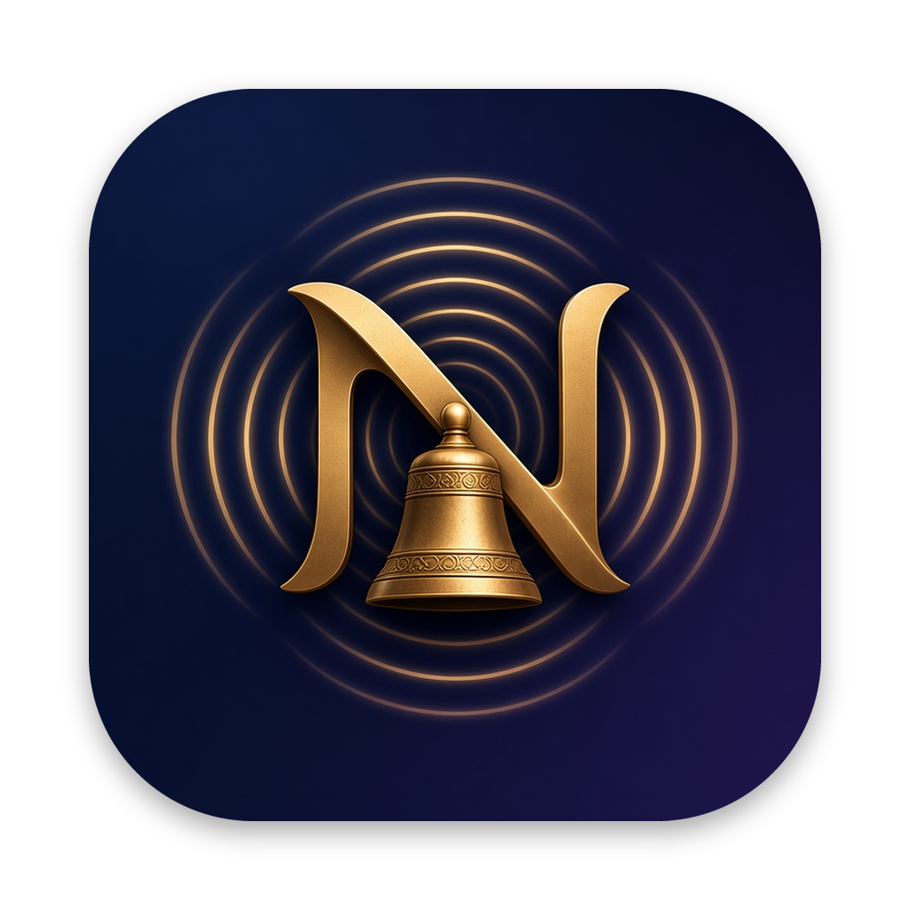

# Nunc Sonat

Nunc Sonat is a menu-bar remote for music that is already playing on an Apple TV, a HomePod, or this Mac. Artwork, title, and transport stay in the menu bar. A mini player can sit on the desktop.

[Download](https://github.com/diligiteiust/NuncSonat-App/releases/latest/download/NuncSonat.dmg) · [Buy Premium](https://diligiteiustitiam.world/nuncsonat/subscribe/)

## What it does

- Shows the current song: artwork, title, artist, album, and progress.
- Play, pause, skip, seek, and the main volume.
- A mini player you can move, resize, and keep on screen.
- AirPlay outputs and a volume slider for each speaker.
- Jump to another song in the playlist.
- Lyrics, including timed `.lrc` files.
- Control Music on another Mac that is also running Nunc Sonat.

## Free and Premium

Free includes now playing, the mini player, play, pause, skip, seek, and the main volume.

Premium adds:

- AirPlay output selection
- Volume on each speaker
- Jump to a song in the playlist
- Lyrics
- Always on top, and panel opacity
- Control of Music on another Mac

A license key works on up to 3 Macs. Paste it in Settings → Premium. [Buy Premium](https://diligiteiustitiam.world/nuncsonat/subscribe/).

## Requirements

- macOS 14 or later, on Apple silicon or Intel.
- An Apple TV running tvOS 15 or later, or a HomePod, on the same network as the Mac.
- Music on this Mac needs Automation access the first time you control it.

## Install

1. [Download NuncSonat.dmg](https://github.com/diligiteiust/NuncSonat-App/releases/latest/download/NuncSonat.dmg).
2. Open the disk image and drag **Nunc Sonat** to **Applications**.
3. Eject the disk image and open **Nunc Sonat** from Applications.
4. The app has no Dock icon. Look for it in the menu bar.

The first time macOS opens an app downloaded from the internet, choose Open. Nunc Sonat is signed and notarized.

## First launch

The welcome screen explains the app, how to pair an Apple TV, and what Free and Premium include. It is shown once.

### Pair an Apple TV

1. Open the menu and choose the Apple TV under **Remotes**.
2. Tap **Pair**.
3. Type the PIN shown on the Apple TV. There are two prompts: the first is the remote PIN, and the second is the AirPlay PIN. Both are saved in the Keychain.
4. A headless Apple TV (no TV attached) has nowhere to show those PINs. Connect a display once, enter both PINs, then the display can come off. Later connections do not ask again.

A HomePod asks for one PIN, shown on a nearby signed-in device. There is no second AirPlay PIN.

Details: [Pairing](docs/pairing.md).

## Permissions

- **Local Network.** macOS asks the first time Nunc Sonat looks for devices. If the menu says access is denied, allow Nunc Sonat in System Settings → Privacy & Security → Local Network.
- **Automation for Music.** Controlling Music on this Mac asks for Automation access. Allow Nunc Sonat to control Music. The same pane is System Settings → Privacy & Security → Automation.

## Guides

- [Pairing an Apple TV or HomePod](docs/pairing.md)
- [AirPlay outputs and speaker volume](docs/outputs.md)
- [Lyrics, including .lrc files](docs/lyrics.md)
- [Control Music on another Mac](docs/multi-mac.md)
- [Licenses and the 3-Mac limit](docs/licensing.md)
- [Troubleshooting](docs/troubleshooting.md)

License and billing questions: [developer@diligiteiustitiam.world](mailto:developer@diligiteiustitiam.world).
