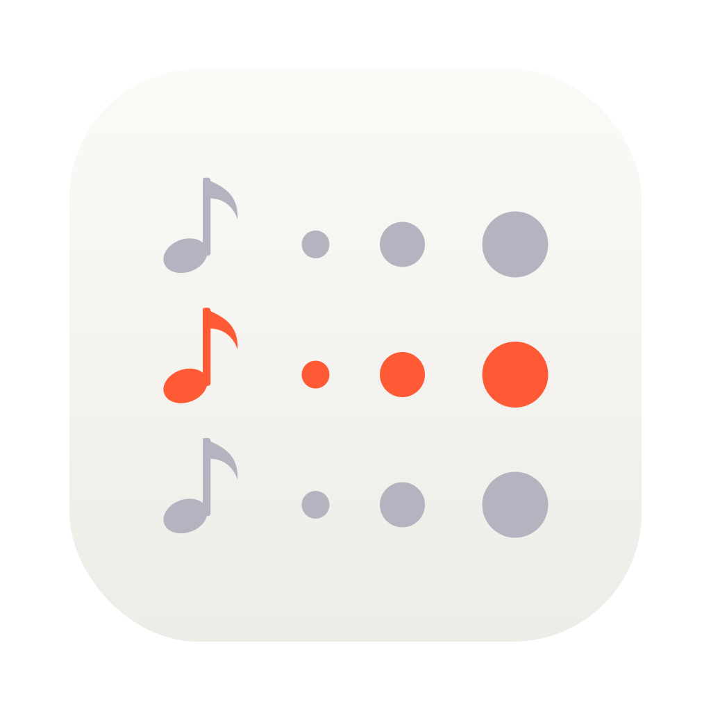
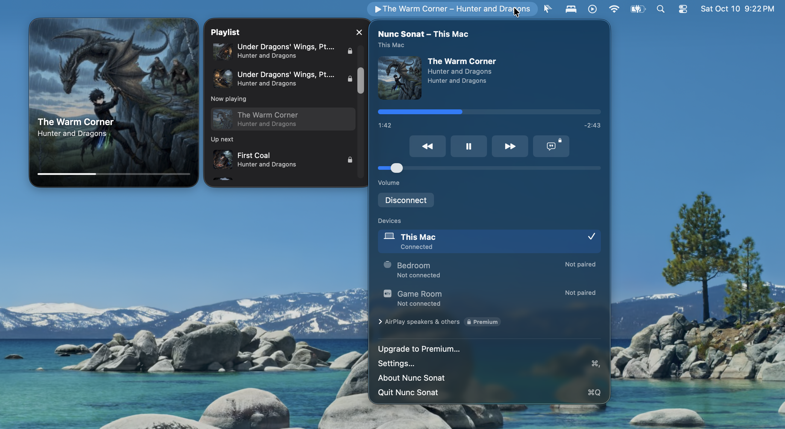
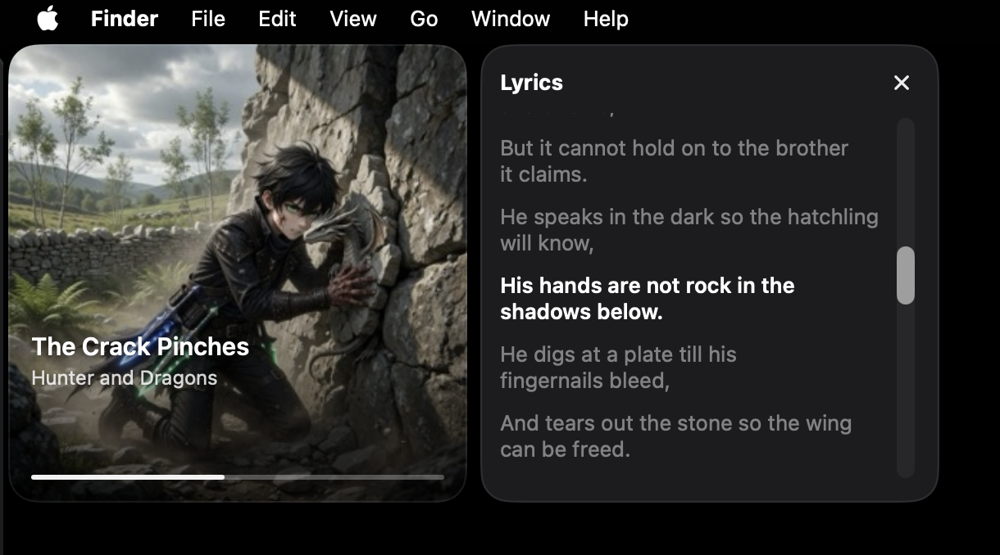

# Nunc Sonat

You work on your Mac, but your music plays on your Apple TV, HomePod or other AirPlay speakers. You don't want to reach for your phone just to switch a playlist, change the volume or see what's playing. You'd rather do it right on your Mac, where your eyes and hands already are. That's what Nunc Sonat is for.

It sits in your menu bar and shows the song that's playing. From there you can pause, skip, change the volume of each speaker, load a different playlist onto your Apple TV, or build playlists from rules like your least played songs.

Since 2.20 there is also a Nunc Sonat app for Apple TV. It pairs with the Mac app and shows what's playing on the TV. The Apple TV app is coming soon to the App Store and can't be installed yet.

[Download](https://github.com/diligiteiust/NuncSonat-App/releases/latest/download/NuncSonat.dmg) · [Buy Premium](https://diligiteiustitiam.world/nuncsonat/subscribe/)

## What it does

- Shows the current song: artwork, title, artist, album, and progress.
- Play, pause, skip, seek, and the main volume.
- A mini player you can move, resize, and keep on screen. Its side panel has Playlist, Lyrics, Info, and Lists tabs.
- Info shows the current song's title, track number, BPM, artist, album, time, genre, language, and when it was last played. You can copy any value.
- Lists shows your Music library playlists and your Nunc Sonat playlists. Double-click one to play it on this Mac, a HomePod, an AirPlay speaker, or the Apple TV.
- Playlist Rules builds a new playlist from the lists you select, filtered by play count, BPM, rating, genre, and how long since a song was played. You can save the result to your Music library.
- AirPlay outputs and a volume slider for each speaker.
- Jump to another song in the playlist.
- Lyrics, including timed `.lrc` files.

  

- Control Music on another Mac that is also running Nunc Sonat.

## The Apple TV app

The Nunc Sonat app for Apple TV is coming soon to the App Store. It can't be installed yet. It's free. The app itself doesn't need Premium, but a few things you do with it from the Mac are Premium, and they're marked below.

- The TV shows what's playing: big artwork, the title, progress, and play, pause, previous, and next.
- Tabs on the right show Playlist, Lyrics, Info, and Settings. You can scroll lyrics and Info with the Siri Remote, and the current lyric line stays in view.
- While it's connected, the Mac sends the TV the lyrics it already has for the song.
- Top Shelf shows the song that is playing, or the last one played.
- The TV stays awake while Nunc Sonat or Now Playing is on screen, so the screen saver doesn't take over.
- From the Mac you can send a Music playlist, or an artist's least-played songs, to the Apple TV (Premium). Play wakes the TV, opens the app, and starts the music. It plays through the Apple TV's own Music player, so it keeps playing if you leave the app.
- You can play on this Mac through the Apple TV's speakers (Premium). The option is in Settings → General → Play on this Mac.
- Several Macs can share one Apple TV (Premium). The Mac that sent the most recent playlist runs the queue, and the other Macs follow the song the TV is playing.

To pair it, see [Pair the Apple TV app](#pair-the-apple-tv-app).

## Free and Premium

Free includes now playing, the mini player, play, pause, skip, seek, the main volume, the Info tab, and the Apple TV app.

Premium adds:

- AirPlay output selection
- Volume on each speaker
- Jump to a song in the playlist
- Lyrics
- The Lists tab and Playlist Rules
- Always on top, and panel opacity
- Control of Music on another Mac
- Sending a playlist, or an artist's least-played songs, to the Apple TV
- Play on this Mac through the Apple TV's speakers
- Sharing one Apple TV between several Macs

A license key works on up to 3 Macs. Paste it in Settings → Premium. [Buy Premium](https://diligiteiustitiam.world/nuncsonat/subscribe/).

## Requirements

- macOS 14 or later, on Apple silicon or Intel.
- An Apple TV running tvOS 16 or later, or a HomePod, on the same network as the Mac. This covers both the remote pairing and the Apple TV app.
- Music on this Mac needs Automation access the first time you control it.

## Install

1. [Download NuncSonat.dmg](https://github.com/diligiteiust/NuncSonat-App/releases/latest/download/NuncSonat.dmg).
2. Open the disk image and drag **Nunc Sonat** to **Applications**.
3. Eject the disk image and open **Nunc Sonat** from Applications.
4. The app has no Dock icon. Look for it in the menu bar.

The first time macOS opens an app downloaded from the internet, choose Open. Nunc Sonat is signed and notarized.

## First launch

The welcome screen explains the app, how to pair an Apple TV, and what Free and Premium include. It is shown once.

### Pair an Apple TV

There are two kinds of pairing. The remote pairing lets the Mac see and control what the Apple TV is playing. The Apple TV app pairing connects the Mac to the Nunc Sonat app on the TV.

#### Remote pairing

1. Open the menu and choose the Apple TV under **Remotes**.
2. Tap **Pair**.
3. Type the PIN shown on the Apple TV. There are two prompts: the first is the remote PIN, and the second is the AirPlay PIN. Both are saved in the Keychain.
4. A headless Apple TV (no TV attached) has nowhere to show those PINs. Connect a display once, enter both PINs, then the display can come off. Later connections do not ask again.

A HomePod asks for one PIN, shown on a nearby signed-in device. There is no second AirPlay PIN.

#### Pair the Apple TV app

This needs the Nunc Sonat app on the Apple TV, which is coming soon to the App Store.

1. On the Mac, open Settings → General → Apple TV app and choose **Pair**.
2. Nunc Sonat wakes the Apple TV, opens the app, and shows a 6-digit code on the TV.
3. Type that code on the Mac.

The connection is encrypted and reconnects by itself. The Apple TV app remembers every Mac it has paired with. Its Settings list each Mac once, mark the one that is connected, and give each Mac its own Forget button.

Details: [Pairing](docs/pairing.md).

## Permissions

- **Local Network.** macOS asks the first time Nunc Sonat looks for devices. If the menu says access is denied, allow Nunc Sonat in System Settings → Privacy & Security → Local Network.
- **Automation for Music.** Controlling Music on this Mac asks for Automation access. Allow Nunc Sonat to control Music. The same pane is System Settings → Privacy & Security → Automation.

## Guides

- [Pairing an Apple TV, the Apple TV app, or a HomePod](docs/pairing.md)
- [AirPlay outputs and speaker volume](docs/outputs.md)
- [Lyrics, including .lrc files](docs/lyrics.md)
- [Control Music on another Mac](docs/multi-mac.md)
- [Licenses and the 3-Mac limit](docs/licensing.md)
- [Troubleshooting](docs/troubleshooting.md)

License and billing questions: [developer@diligiteiustitiam.world](mailto:developer@diligiteiustitiam.world).
